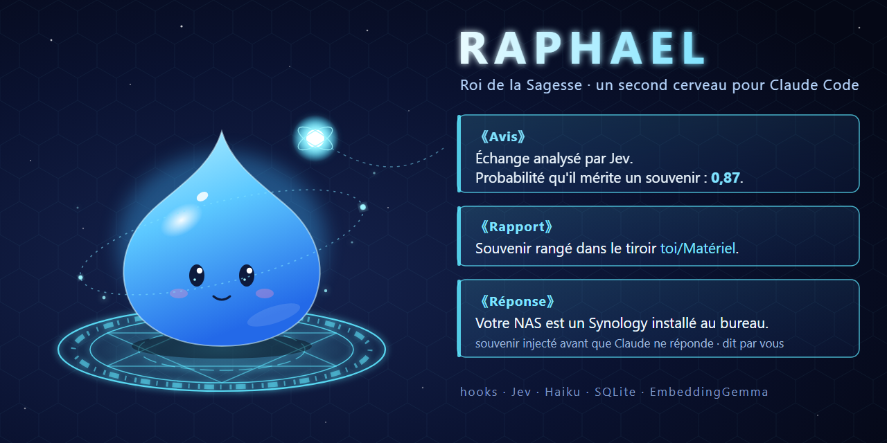
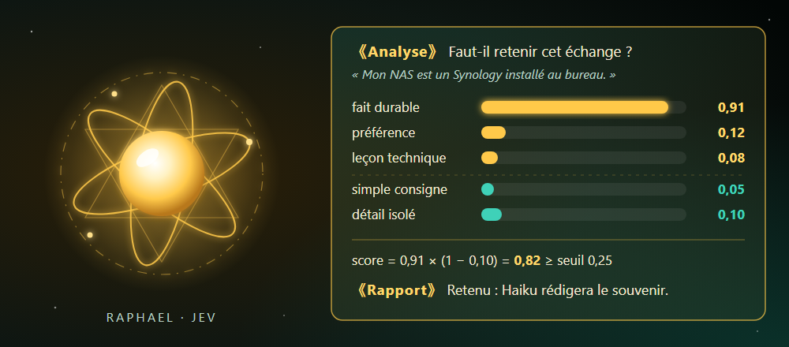

<div align="center">

# Raphael

### Un second cerveau déterministe pour Claude Code.

Des hooks capturent chaque échange, Jev décide avec des probabilités, et vos souvenirs reviennent au bon moment, dans toutes vos sessions.

   -3fd1b8?style=flat-square&labelColor=0e1612) [](https://github.com/tpierrain/kenjaku)

[Pourquoi Raphael ?](#pourquoi-raphael-) · [Installation](#installation) · [Les portes](#les-portes) · [Jev](#jev--décider-avec-des-probabilités-pas-avec-la-bonne-volonté-dun-llm) · [Raphael et Kenjaku](#raphael-et-kenjaku)

</div>

<p align="center">
  
</p>

<p align="center"><sub><b>《Réponse》</b> Je retiens ce qui compte dans vos conversations, et je vous le rappelle avant même que vous ne le demandiez.</sub></p>

## Pourquoi Raphael ?

Raphael donne une mémoire à long terme à [Claude Code](https://claude.com/claude-code). C'est une **adaptation directe de [Kenjaku](https://github.com/tpierrain/kenjaku)**, le second cerveau de Thomas Pierrain, dont il reprend les principes et une bonne partie des mécanismes, réécrits en Python pour une autre façon de capturer et de rappeler.

Sa particularité : **le moment et la règle de chaque décision sont déterministes**. Ce n'est pas le LLM qui décide seul de mémoriser (il oublie, ou retient n'importe quoi) : des hooks soumettent chaque échange à un modèle de décision spécialisé, Jev, dont les probabilités sont comparées par le code à des seuils fixes.

| Retenir | Rappeler | Cloisonner |
| --- | --- | --- |
| Chaque échange est capturé par un hook ; Jev décide de le retenir, d'attendre la suite ou de le rejeter, et Haiku rédige le souvenir en arrière-plan. | Avant que Claude ne lise votre message, Raphael cherche par le sens et par les mots, puis injecte au plus 5 souvenirs que Jev juge pertinents. | Les souvenirs sont rangés dans un arbre de tiroirs et séparés par univers (perso, employeur, clients) : un fait d'un client ne ressort jamais chez un autre. |

### Dans Claude Code

- **Une présence invisible** : actif dans toutes les sessions, quel que soit le dossier, sans rien ouvrir ni rien charger au démarrage.
- **Une bannière de santé** à chaque nouvelle session : `🧠 Cerveau Jev · 142 souvenirs · univers perso · ✅ en forme`.
- **Des souvenirs injectés d'office**, avec leur type et leur fiabilité (*dit par vous*, *constaté*, *déduit*).
- **Des annonces discrètes** : ce que Raphael a retenu s'affiche au message suivant.
- **Une correction en un mot** : `faux 2` ou `inutile`, sans dépenser un seul token.

```
🧠 Capitalisé :
  · Le NAS de l'utilisateur est un Synology installé au bureau.
🔎 1 souvenir(s) injecté(s) (réponds « faux 2 » ou « inutile » pour corriger) :
  [1] Le NAS de l'utilisateur est un Synology installé au bureau.
```

Répondre `faux 2` désactive aussitôt le souvenir n° 2 ; `inutile` le note comme tel (désactivé au bout de 3). Ces messages sont interceptés par la porte 1 et n'arrivent jamais à Claude : 0 token.

## Installation

> [!NOTE]
> Prérequis : **Windows** uniquement (`msvcrt`, `winreg`, processus détachés), Python 3.14 (testé), Claude Code installé et connecté (`claude` dans le PATH), une clé API TypeSafe (Jev), et environ 1,4 Go de RAM pour le service d'embeddings (il s'arrête seul après 30 min d'inactivité).

```powershell
git clone https://github.com/TristanBqn/Raphael.git
cd Raphael
py -3.14 -m venv .venv
.venv\Scripts\python.exe -m pip install -r requirements.txt

# Modèle d'embeddings (≈ 300 Mo, licence Gemma)
.venv\Scripts\hf.exe download onnx-community/embeddinggemma-300m-ONNX config.json tokenizer.json tokenizer_config.json onnx/model_quantized.onnx onnx/model_quantized.onnx_data --local-dir modeles/embeddinggemma-300m-ONNX

# Clé Jev (variable d'environnement utilisateur)
setx TYPESAFE_API_KEY "votre_cle"

# Vérification
.venv\Scripts\python.exe spikes\test_jev.py
```

Puis :

1. Copier `cerveau/config_local.exemple.py` en `cerveau/config_local.py` et l'adapter (voir ci-dessous).
2. Ajouter le contenu de `exemples/settings.hooks.json` dans `~/.claude/settings.json`, en remplaçant `C:/chemin/vers/Raphael` par le chemin réel.
3. Ouvrir une nouvelle session Claude Code : la bannière `🧠 Cerveau Jev · …` confirme que les hooks tournent.

Optionnel : importer l'historique Claude Code existant avec `.venv\Scripts\python.exe cerveau\import_historique.py` (`--evaluer-seulement` pour estimer d'abord le coût).

> [!IMPORTANT]
> **Confidentialité** — Le texte des échanges est **envoyé à l'API TypeSafe** (Jev) pour évaluation, et à Claude Haiku pour la rédaction des souvenirs. Les secrets reconnus (clés, jetons, mots de passe) sont masqués avant tout stockage ou envoi (`cerveau/masque.py`), mais ce masquage reste heuristique. Tout le reste est local : base SQLite et journal dans `data/cerveau/` (ignoré par git), embeddings calculés sur la machine, service limité à `127.0.0.1`. Les textes bruts des échanges sont purgés après 90 jours ; seuls les souvenirs rédigés restent.

### Régler Raphael

Les réglages personnels vont dans `cerveau/config_local.py`, non versionné, qui surcharge `cerveau/config.py` (seuils, modèles et chemins) :

| Réglage | Où | Rôle |
| --- | --- | --- |
| `PRENOM` | `config_local.py` | Votre prénom, utilisé par le rédacteur et à l'injection (« dit par … »). |
| `SPHERE_PERSO` | `config_local.py` | Exemples de votre sphère personnelle, donnés au rédacteur. |
| `UNIVERS` | `config_local.py` | Motifs de chemin associés à un univers (employeur, clients) ; `perso` par défaut. |
| `EXCLUSIONS` | `config_local.py` | Dossiers où les hooks ne font rien (par exemple un autre cerveau). |
| `TYPESAFE_API_KEY` | variable d'environnement | Clé de l'API Jev. |
| `SECOND_CERVEAU_DATA` | variable d'environnement | Autre dossier de données, pratique pour tester sans toucher à la vraie base. |

## Fonctionnement

### Les portes

Raphael s'accroche aux événements de Claude Code par quatre hooks. Les deux « portes » sont celles par lesquelles passe chaque échange : la porte 1 rappelle ce qui sert avant que Claude ne lise votre message, la porte 2 dépose l'échange pour qu'il soit jugé et rédigé en arrière-plan.

<p align="center">
  
</p>

<p align="center"><sub>Le trajet d'un message : la porte 1 rappelle, Claude répond, la porte 2 dépose ; le reste se passe en coulisses.</sub></p>

**Porte 1, le rappel** (environ 0,65 s par message). Avec votre message et les 2 échanges précédents, en un seul appel, Jev dit si le message a besoin de la mémoire, s'il ne porte que sur le projet ouvert, quels tiroirs proches le concernent vraiment, et quels candidats sont pertinents. Trois voies d'injection : normale (besoin ≥ 0,5 puis pertinence ≥ 0,35), pertinence forte (une question qui paraît générale mais qu'un souvenir personnel change, comme « comment dois-je signer mes commits ? »), et rattrapage (le besoin est net, Jev hésite, le candidat le plus proche par le sens passe). Si Jev met plus de 1,5 s, une heuristique locale prend le relais. Les échanges capturés mais pas encore rédigés restent retrouvables.

**Porte 2, la capture.** Elle ne fait aucun appel réseau : elle ajoute la réponse de Claude à l'échange et réveille le worker, qui travaille en arrière-plan sans jamais bloquer la conversation.

**Le worker** (un seul à la fois) fait évaluer chaque échange par Jev. Un problème encore ouvert est mis **en attente**, puis réexaminé avec la suite de la conversation : on ne mémorise pas une erreur avant de savoir comment elle s'est résolue. Une demande explicite (« retiens que… », « souviens-toi… ») est toujours retenue. Haiku rédige par lots (3 échanges, 10 minutes ou la fin de la session), **sans aucun outil** : le contenu d'un échange ne peut rien faire exécuter. Un souvenir devenu faux est remplacé, et les textes bruts des échanges sont purgés après 90 jours.

### Jev : décider avec des probabilités, pas avec la bonne volonté d'un LLM

<p align="center">
  
  <br><sub><i>Raphael, le Roi de la Sagesse. Image : <a href="https://tensei-shitara-slime-datta-ken.fandom.com/wiki/Raphael">wiki Fandom de Tensura</a>.</i></sub>
</p>

**Ce qu'est Jev.** Jev est un modèle *System One* de [TypeSafe](https://docs.typesafe.ai) : un petit modèle rapide qui n'écrit rien, il **répond à des questions typées** sur un état JSON.

- `Noul` : une question oui/non, qui renvoie la probabilité du « oui » (de 0 à 1) ;
- `Choice` : une option parmi plusieurs, avec la probabilité de chacune et une confiance ;
- `Score` : un niveau sur une échelle ordonnée.

Toutes les questions d'un appel sont évaluées en parallèle, en 150 à 250 ms environ, pour 0,042 $ par million de tokens en entrée. Les modèles System One sont entraînés à être **calibrés** : leurs probabilités sont optimisées pour refléter l'incertitude réelle, mesurée sur des groupes de prédictions (ce qui ne garantit pas chaque réponse prise isolément).

**Pourquoi c'est pertinent.** Demander à un LLM « faut-il retenir cet échange ? » donne une réponse en prose, qui varie d'une fois sur l'autre, et qu'on ne peut ni mesurer ni régler. Jev donne un **nombre**, et un nombre se compare à un seuil fixé dans le code, se mesure et se règle :

<p align="center">
  
</p>

- **La décision devient reproductible.** Les probabilités de Jev peuvent varier de quelques centièmes d'un appel à l'autre, mais la règle de décision, elle, est écrite dans `config.py`. Mesuré sur trois échanges jugés 8 fois chacun : l'écart-type reste sous 0,013 et aucune décision n'a changé ; seul un score à quelques centièmes du seuil pourrait basculer.
- **La grille de capture est mesurée.** Sur un jeu de 50 passages annotés à la main, une seule question « faut-il retenir ? » plafonnait à une AUC de 0,69 et se trompait plus souvent que « tout garder ». Découpée en 7 questions atomiques combinées par le code, la grille monte à 0,80 :
  ```
  positif   = max(fait, préférence, leçon, règle de projet, événement daté)
  exclusion = max(simple consigne pour la tâche en cours, détail isolé)
  score     = max(positif × (1 − exclusion), événement daté)   → retenu si score ≥ 0,25
  ```
- **Les seuils suivent le coût d'une erreur.** Injecter un souvenir en trop coûte quelques tokens ; en rater un coûte une mauvaise réponse. Le rappel a donc des seuils bas, la capture des seuils plus stricts.

| Décision | Question posée à Jev | Règle appliquée par le code |
| --- | --- | --- |
| Retenir un échange | 5 critères positifs et 2 exclusions | score ≥ 0,25 |
| Attendre la suite | « Le problème est-il encore ouvert ? » | ≥ 0,6 : réexaminé avec la suite de la conversation, 3 fois au plus |
| Chercher dans la mémoire | « La réponse a-t-elle besoin d'informations sur vous ? » | ≥ 0,5 |
| Injecter un souvenir | « Ce souvenir aide-t-il à répondre ? » | ≥ 0,35, ou ≥ 0,7 si la question semble générale |
| Mode projet | « Le message ne porte-t-il que sur le projet ouvert ? » | ≥ 0,5 : seules les préférences et leçons générales passent |
| Ouvrir un tiroir proche | « Le message parle-t-il de ce sujet ? » | ≥ 0,5 |

**Le contexte fourni à Jev.** Un message comme « oui, fais-le » ou « et sur l'autre machine ? » ne veut rien dire pris seul : juger une phrase isolée fausserait les probabilités. À la porte 1, Jev reçoit donc votre message accompagné des **2 échanges précédents** de la conversation (votre message et la réponse de Claude), chacun **coupé à 300 caractères**, du plus récent au plus ancien (`CONTEXTE_ECHANGES` et `CONTEXTE_CARACTERES` dans `config.py`). La consigne lui demande de juger votre message, les échanges précédents servant seulement à comprendre à quoi il renvoie. Pourquoi pas davantage : la précision de Jev baisse quand l'état qu'on lui envoie grossit, et le contexte doit éclairer la décision sans la noyer. Haiku reçoit le même contexte quand il rédige. À la capture, Jev juge l'échange lui-même ; s'il le met en attente, il le réexamine ensuite avec les 3 échanges qui suivent.

Les questions sont écrites en anglais (Jev le gère mieux que le français) et le contenu reste en français. La version du modèle est épinglée (`jev-1.13.0`) : les seuils sont réglés pour elle.

**Et ensuite.** Toutes les décisions passent par un seul module, `cerveau/decideur.py`. Dans la continuité, **Jev sera remplacé par un modèle local comme Laya** : mêmes questions, seuils revalidés sur le jeu d'évaluation, et plus aucun échange envoyé à l'extérieur pour décider.

### Le classement : univers, projets et tiroirs

Kenjaku range des notes dans un wiki ; Raphael range des souvenirs d'une phrase, à trois niveaux.

**Les univers** (repris de Kenjaku) cloisonnent. Un motif dans le chemin du dossier de travail désigne l'univers (`cerveau/config_local.py`) : `perso` par défaut, un employeur, un client. Un souvenir sur vous-même (votre machine, vos préférences) est **commun** et ressort partout ; un souvenir d'univers ne ressort que dans cet univers. Depuis un dossier client, vous ne verrez ni votre vie perso ni un autre client.

**Les projets** suivent git. Le projet d'un échange est la racine git du dossier ; votre dossier personnel, Documents ou Téléchargements n'en sont pas. Un souvenir a une **portée** générale ou propre à un projet. Et quand un message ne porte que sur le projet ouvert (« corrige ce bug », « pousse sur GitHub »), Raphael passe en **mode projet** : ce sont les fichiers et git qui font foi, donc aucun fait mémorisé n'est injecté, seulement vos préférences et leçons générales. Les règles d'un projet relèvent de son `CLAUDE.md` et ne sont pas capturées ; un fait qui ne se lit pas dans ses fichiers (l'emplacement d'une archive, un hébergement) est retenu.

**Les tiroirs** organisent, comme un entonnoir : une hiérarchie définie, où chaque souvenir descend de la racine vers le tiroir le plus précis qui lui correspond.

<p align="center">
  
</p>

<p align="center"><sub>Les noms entre chevrons sont des exemples : les tiroirs se créent au fil de vos souvenirs.</sub></p>

Haiku descend l'arbre et range chaque souvenir dans le tiroir le plus profond qui convient ; il ne crée un tiroir que pour une catégorie durable, jamais pour une anecdote. Le code garantit qu'un sujet n'existe qu'à un seul endroit (un même nom, sans accents ni casse, renvoie au tiroir existant). Au rappel, Raphael n'ouvre que les tiroirs utiles : `toi` et `toi/Outils`, le tiroir du dossier courant, ceux que le message nomme (par leur nom ou un mot-clé), et jusqu'à 3 sujets proches par le sens que Jev doit confirmer. Ouvrir un tiroir ouvre ses parents et ses sous-tiroirs.

Chaque souvenir porte enfin un **type** (fait, préférence, leçon, décision de projet, événement daté avec sa date d'expiration) et une **fiabilité** (dit par vous, constaté, déduit), affichés à l'injection.

## Raphael et Kenjaku

### Deux philosophies

Adaptation directe ne veut pas dire copie : les deux projets ne répondent pas au même besoin.

- **Kenjaku est un lieu où l'on va** : un wiki LLM « à la Karpathy » (Markdown, compatible Obsidian, versionné dans git), alimenté par vos sources de travail (Slack, Drive, Gmail, Notion, transcriptions de réunions…). On ouvre son cerveau pour lui demander *« qu'a-t-on décidé sur le projet X, et qui s'en occupe ? »*.
- **Raphael est une présence qui vous suit** : une couche invisible dans *toutes* vos sessions Claude Code, quel que soit le dossier. Il apprend de vos conversations avec Claude (votre machine, vos comptes, vos préférences, les leçons tirées d'une erreur, les décisions de vos projets) et injecte de lui-même ce qui sert, au moment où vous écrivez.

<p align="center">
  
</p>

<p align="center"><sub>Kenjaku laisse décider le LLM pendant la réponse, avec votre accord ; Raphael fait décider Jev avant et après, contre des seuils fixes.</sub></p>

| | **Kenjaku** | **Raphael** |
| --- | --- | --- |
| **Usage** | On ouvre le dossier du cerveau (CLI ou Claude Desktop) pour l'interroger | Actif dans toutes les sessions Claude Code, sans rien ouvrir |
| **Ce qu'il retient** | Vos sources de travail : messages, documents, réunions, notes | Vos conversations avec Claude Code |
| **🔎 Rappeler** | | |
| Quand | Pendant la réponse, si Claude décide de chercher | Avant que Claude ne lise votre message, à chaque message |
| Qui décide | Claude, guidé par sa constitution, interroge le serveur MCP `vault-rag` | Le code déclenche la porte 1 ; **Jev** note chaque souvenir candidat ; le code garde ceux qui passent le seuil |
| Comment | RAG local (EmbeddingGemma, ou une API, ou Ollama) sur un index vectoriel SQLite | Hybride EmbeddingGemma + plein texte FTS5, fusion par rang (RRF), puis tri final par Jev, limité aux tiroirs utiles |
| **🧠 Retenir** | | |
| Quand | Pendant la conversation, quand Claude juge qu'un échange en vaut la peine | Après chaque réponse, en arrière-plan ; un problème encore ouvert attend la suite de la conversation |
| Qui décide | Claude propose une note (`/file-back`) ; **vous validez** | **Jev** juge chaque échange (retenir, attendre la suite, rejeter) ; vous n'êtes pas sollicité |
| Qui écrit | Des scripts testés : la note est conforme par construction, puis commit et push automatiques | Haiku rédige ; le code range dans les tiroirs et évite les doublons |
| Stockage | Notes Markdown + `[[wikilinks]]`, dans votre dépôt git | Base SQLite : souvenirs atomiques d'une phrase, datés, avec leur fiabilité et une date d'expiration éventuelle |
| Correction | On édite les notes, dans Obsidian ou ailleurs | On répond `faux 2` ou `inutile` au message suivant |
| **⚖️ Déterminisme** | | |
| Toujours la même règle | L'écriture : garde-fous, scripts de construction, versionnement automatique | Le déclenchement et la décision : chaque échange est jugé au même moment, contre un seuil écrit dans le code |
| Ce qui reste un jugement | Chercher ou retenir : c'est Claude qui y pense, et vous qui confirmez | La probabilité donnée par Jev (stable à quelques centièmes près) et la rédaction par Haiku |
| **🧰 En pratique** | | |
| Coût en contexte | Une constitution `CLAUDE.engine.md` (environ 60 Ko) chargée à chaque session | Rien au démarrage ; quelques lignes injectées seulement quand un souvenir sert |
| Pile | Node.js ≥ 20, macOS et Windows, installateur guidé | Python 3.14, Windows uniquement |
| Public visé | Tout le monde, y compris sans profil technique | Utilisateurs de Claude Code à l'aise avec Python |
| Maturité | Versions publiées, moteur qui se met à jour seul, tests de mutation, ADR | Projet personnel, sans tests automatisés |

### Ce que Raphael doit à Kenjaku

Rendons à César ce qui est à César. Raphael reprend de [Kenjaku](https://github.com/tpierrain/kenjaku) :

1. **Le principe directeur** : du déterminisme partout où c'est possible, avec des hooks déclenchés par de vrais événements plutôt que par la bonne volonté du modèle, et le LLM seulement là où son jugement apporte quelque chose. Raphael pousse ce principe jusqu'à la décision de mémoriser.
2. **Les univers** (ADR 0034 de Kenjaku) : un périmètre souple par employeur, client ou sphère de vie, pour qu'une information ne déborde pas de son contexte. Raphael déduit l'univers du dossier de travail et en fait les racines de son arbre de tiroirs.
3. **La discipline d'affirmation** : une absence n'est jamais générale. À chaque rappel, Raphael rappelle à Claude que l'absence d'un souvenir ne prouve pas l'absence du fait (« je n'ai pas trouvé » plutôt que « ça n'existe pas »).
4. **Les paliers de source** (`verbatim` > `conversation` > `human-summary` > `ai-summary`) et le garde-fou contre les résumés d'IA, devenus la **fiabilité** de chaque souvenir : *dit par vous*, *constaté* par un résultat, ou *déduit* ; et la règle de ne mémoriser que ce que vous avez affirmé ou qu'un résultat a confirmé.
5. **Le bilan de santé au démarrage** : comme le `session-health` de Kenjaku, Raphael affiche à chaque nouvelle session le dernier verdict connu pendant qu'une nouvelle sonde tourne en arrière-plan. La bannière elle-même est reprise de Kenjaku :
   ```
   🧠 Cerveau Jev · 142 souvenirs · univers perso · ✅ en forme
   ```
6. **Le lint déterministe** (`lint-vault` : liens morts, notes orphelines, pages périmées), transposé à une base de souvenirs : souvenirs sans vecteur, expirés, quasi-doublons, contradictions, jamais utilisés, jugés inutiles, échanges bloqués.
7. **EmbeddingGemma-300M en local** (ONNX quantifié), avec les mêmes préfixes de tâche (`task: search result | query: ` et `title: none | text: `).
8. **Un modèle d'embeddings gardé en mémoire** par un service local (le serveur MCP `vault-rag` de Kenjaku), plutôt que rechargé à chaque question.
9. **L'échec silencieux** (*fail-open*) : un hook qui plante journalise et se tait, il ne casse jamais la session.

Le code est réécrit en Python et adapté à SQLite : aucun fichier de Kenjaku n'est copié.

## D'où vient le nom ?

Dans *Moi, quand je me réincarne en Slime* (*Tensei Shitara Slime Datta Ken*), Raphael, le « Roi de la Sagesse », est la compétence qui vit dans la tête du héros : elle analyse tout ce qui se passe, garde tout en mémoire et répond aussitôt, par de courts messages **《Avis》**, **《Rapport》** ou **《Réponse》**.

C'est exactement le rôle de ce projet auprès de Claude : une voix intérieure qui analyse chaque échange, range ce qui mérite de l'être, et souffle la bonne information au bon moment. Le nom suit aussi la tradition de Kenjaku, baptisé d'après un personnage de *Jujutsu Kaisen* : à chacun son personnage d'anime.

## Développement

Les hooks, le worker, les décisions Jev, le stockage et les tiroirs se trouvent dans `cerveau/` ; l'architecture détaillée et les invariants sont décrits dans [`CLAUDE.md`](CLAUDE.md).

| Dossier | Contenu |
| --- | --- |
| `cerveau/` | Hooks, worker, décisions Jev, stockage, embeddings, tiroirs |
| `outils/` | Chaîne d'évaluation : jeu Word annoté à partir de l'historique, classement par Jev |
| `spikes/` | Test de la clé Jev, conversion Word → PDF |
| `docs/` | Notes sur la documentation Jev |
| `exemples/` | Déclaration des hooks pour `~/.claude/settings.json` |
| `assets/` | Illustrations et schémas : portes, décisions, tiroirs (sources SVG et HTML, rendus PNG) |

Le projet n'a pas de tests automatisés. Pour vérifier une installation ou un changement :

```powershell
.venv\Scripts\python.exe spikes\test_jev.py                   # clé Jev et latence
.venv\Scripts\python.exe cerveau\sante.py --sonde --afficher  # bilan de santé
```

Le journal `data/cerveau/cerveau.log` contient une ligne JSON par événement. Toute modification des questions ou des seuils de `cerveau/decideur.py` et `cerveau/config.py` devrait être revalidée sur un jeu d'évaluation annoté.

## Crédits et remerciements

Un grand merci à [Thomas Pierrain](https://github.com/tpierrain) : sans Kenjaku, Raphael n'existerait pas. Ses principes (du déterminisme partout où c'est possible, des univers, la discipline d'affirmation) et la générosité avec laquelle il les a documentés et publiés ont servi de fondation à tout ce projet.

- [Kenjaku](https://github.com/tpierrain/kenjaku), de Thomas Pierrain (Apache 2.0) : Raphael en est une adaptation directe (voir [Ce que Raphael doit à Kenjaku](#ce-que-raphael-doit-à-kenjaku)).
- [Jev](https://docs.typesafe.ai) (TypeSafe) pour les décisions, [EmbeddingGemma](https://huggingface.co/onnx-community/embeddinggemma-300m-ONNX) (Google) pour les embeddings.
- *Moi, quand je me réincarne en Slime* (*Tensei Shitara Slime Datta Ken*) est l'œuvre de Fuse. Le nom de Raphael est un hommage de fan ; l'image de Raphael de la section Jev est tirée de l'anime (via le wiki Fandom de la série, droits réservés à leurs détenteurs) ; la bannière, le schéma d'analyse, le diagramme des portes, le schéma des décisions et l'arbre des tiroirs sont des créations originales. Ce projet n'est affilié ni à l'œuvre ni à ses éditeurs.

---

Créé par [Tristan Bannier](https://github.com/TristanBqn) · Adapté de [Kenjaku](https://github.com/tpierrain/kenjaku)
